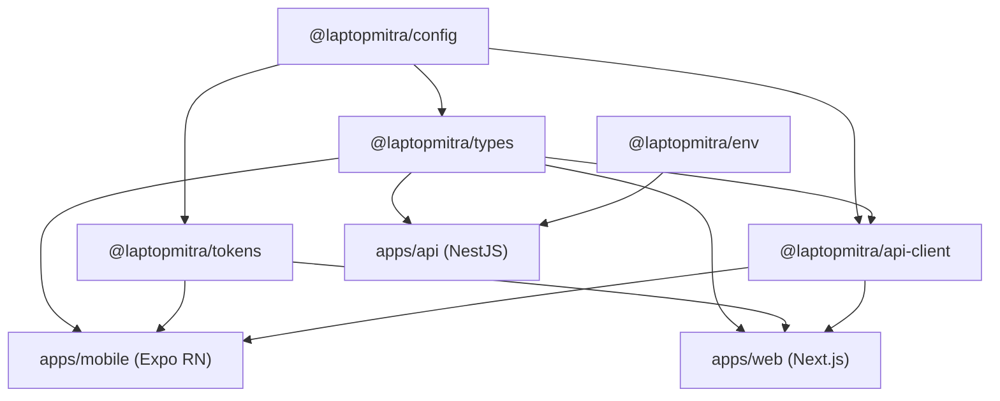
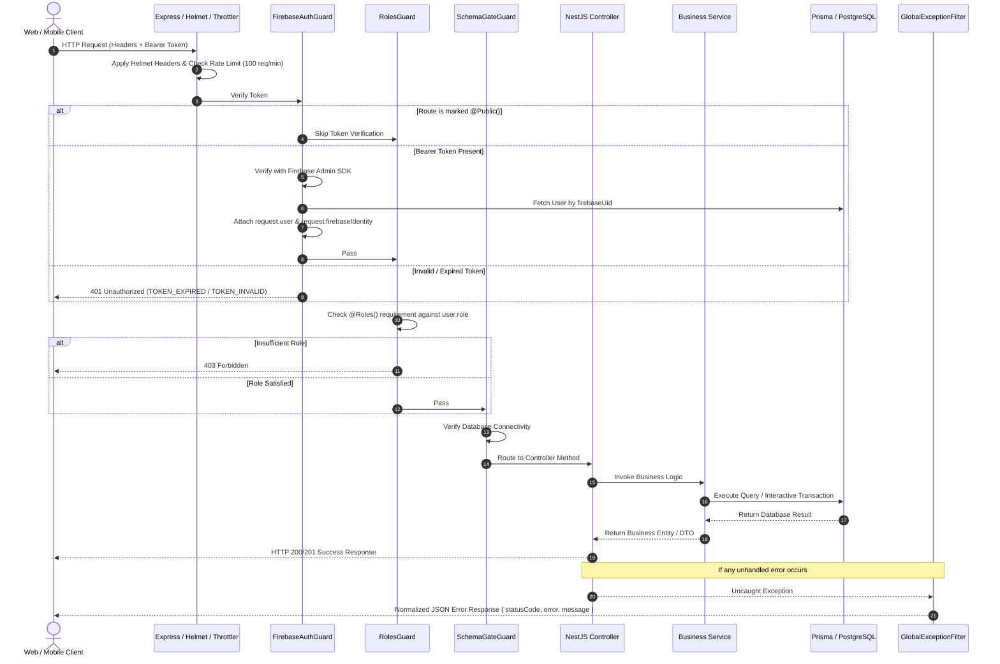

# LaptopMitra — AI Handoff: Architecture

## 1. Monorepo Architecture & Dependency Graph

LaptopMitra is structured as a Turborepo monorepo with `pnpm` workspaces. Cross-package dependencies are linked using `workspace:*` references.

```
laptopmitra/
├── apps/
│   ├── api/          [NestJS Backend API]
│   ├── web/          [Next.js 16 Web Application]
│   └── mobile/       [Expo React Native Application]
├── packages/
│   ├── types/        [@laptopmitra/types - Core DTOs & Interfaces]
│   ├── tokens/       [@laptopmitra/tokens - Design Tokens]
│   ├── api-client/   [@laptopmitra/api-client - Universal API Client]
│   ├── env/          [@laptopmitra/env - Zod Runtime Config Validation]
│   └── config/       [@laptopmitra/config - Shared TS & Lint configs]
├── rules/            [Engineering & Security Guidelines]
├── docs/             [Deployment & Technical Documentation]
└── scripts/          [Database & Environment Tooling]
```

### Dependency Flow Diagram



> [!IMPORTANT]
> **Compilation Rule**: `packages/types`, `packages/tokens`, and `packages/api-client` must be built (`pnpm --filter "@laptopmitra/*" build`) before running type checking or builds in `apps/web` or `apps/mobile`.

---

## 2. Directory Structure & Key Responsibilities

### Root Directory
- `package.json`: Monorepo root scripts (`build`, `dev`, `lint`, `test`, `type-check`, `doctor`, `db:dev:*`).
- `turbo.json`: Pipeline configuration defining task dependencies (`build`, `test`, `lint`, `type-check`).
- `pnpm-workspace.yaml`: Declares `apps/*` and `packages/*` as active workspaces.
- `.db-protected-hosts`: Protected hostname list guarding production PostgreSQL against unintended migrations or resets.
- `render.yaml`: Infrastructure-as-code blueprint for deploying the NestJS API to Render.

### `apps/api` (NestJS REST API)
- `src/main.ts`: Application bootstrap; configures Helmet, hardened CORS callback, global ValidationPipe, Swagger, and port binding.
- `src/app.module.ts`: Root module importing all feature modules, configuring global filters (`GlobalExceptionFilter`), global throttler, and global `FirebaseAuthGuard`.
- `src/prisma/`: Prisma client module and service with lifecycle hooks.
- `src/auth/`: Firebase Auth token validation, profile synchronization, OTP email challenges, guest linking.
- `src/guards/`: `roles.guard.ts` (enforces `CUSTOMER`, `ADMIN`, `MODERATOR`), `schema-gate.guard.ts` (verifies DB health).
- `src/decorators/`: Custom metadata decorators (`@Public()`, `@Roles()`, `@CurrentUser()`, `@AllowUnlinkedFirebaseUser()`).
- `src/modules/`:
  - `admin/`: Product catalog management, user 360 overview, order cancellations, affiliate audit, withdrawal approvals.
  - `cart/`: Add/update/remove items, calculate cart totals, stock availability checks.
  - `discount/`: Unified coupon validation, referral code verification, commission payouts with AES-256-GCM encrypted banking snapshots.
  - `order/`: Order placement, stock reservation lifecycle, return requests, tracking, PDF invoicing, leasing/rentals.
  - `payments/`: Razorpay order initialization, subscription mandates, webhook verification, signature validation.
  - `product/`: Catalog querying, faceted filters, search.
  - `service/`: Digital device passport, warranty entitlement, doorstep service bookings with sequence numbers (`SRV-*`).
  - `support/`: Situation diagnosis engine, customer tickets, return processing, buyback guarantee lifecycle, CRM notes.
  - `shipping/`: Pincode serviceability engine.
  - `mail/`: Transactional email delivery via Resend, SMTP, or Console.
- `prisma/`:
  - `schema.prisma`: Canonical 37-model relational database schema.
  - `migrations/`: Versioned SQL migration history.
  - `seed-catalog.ts`, `seed-dev-orders.ts`: Database seeding fixtures.
- `scripts/`: Safety checks (`database-safety.cjs`), admin promotion, preflight validation.

### `apps/web` (Next.js 16 App Router)
- `app/layout.tsx`: Root HTML layout; injects font, global providers (QueryClientProvider, AuthProvider), and toast containers.
- `app/page.tsx`: Landing page with hero banner, categories, featured laptops, rental highlights, and customer reviews.
- `app/products/`: Catalog listing with server/client filtering by brand, processor, RAM, and price.
- `app/products/[id]/`: Product detail page with image gallery, variant selector, rental plan options, specifications, and warranty badges.
- `app/cart/`: Cart review, item quantity management, stock alerts.
- `app/checkout/`: Multi-step checkout (Address, Shipping, Coupon/Referral code, Razorpay modal integration).
- `app/account/`: Customer portal:
  - `orders/`: Order history, tracking, PDF invoice download, returns.
  - `laptops/`: Digital device passport, serial tracking, warranty coverage, book free service.
  - `referral/`: Mitra affiliate dashboard, earnings ledger, payout banking details setup, withdrawal requests.
  - `tickets/`: Support ticket history, threaded discussions, create new ticket.
  - `returns/`: Return request status and refund detail configuration.
- `app/admin/`: Staff/Admin management consoles:
  - `dashboard/`: Key metrics (revenue, orders, active tickets, pending withdrawals).
  - `products/`: Product catalog editor, CSV bulk import/export, variant management.
  - `orders/`: Order lifecycle management, status updates, item-level cancellations, manual refunds.
  - `affiliates/`: Mitra partner oversight, withdrawal queue, encrypted bank details modal, QR code viewer.
  - `support/`: Ticket triage, assign staff, internal notes, saved replies, merge tickets.
  - `service/`: Technician dispatch, warranty lookup by serial number, schedule reminders.
  - `buyback/`: Inspect returned buyback laptops, submit revised quote, process buyout.
- `components/`: Modular UI widgets (NavBar, Footer, ProductCard, AdminHeader, Modal, Accordion, etc.).
- `lib/`: Universal API helpers (`api.ts`, `admin-api.ts`), Firebase client initialization (`firebase.ts`), validation helpers.

### `apps/mobile` (Expo React Native)
- `index.ts`: Application entry point registered with Expo.
- `src/App.tsx`: Navigation container with React Query and Auth context providers.
- `src/navigation/`:
  - `RootNavigator.tsx`: Decides between Auth Stack and Main App Stack.
  - `BottomTabNavigator.tsx`: Main bottom tabs (`Home`, `Store`, `Cart`, `Account`).
  - `AccountStackNavigator.tsx`: Stack for My Laptops, Orders, Mitra Referral, Support Tickets, Returns, Settings.
- `src/screens/`: 35+ screen components matching Web functionality natively.
- `src/api/client.ts`: Instantiated `@laptopmitra/api-client` wired with Expo SecureStore and Firebase token refresh.
- `src/theme/`: Native styling abstractions mapping tokens to React Native StyleSheet objects.

---

## 3. Application Entry Points

### 1. API Gateway (`apps/api/src/main.ts`)
```typescript
const app = await NestFactory.create<NestExpressApplication>(AppModule, { rawBody: true });
// 1. Production CORS validation
// 2. Helmet security headers
// 3. Global ValidationPipe (whitelist: true, transform: true)
// 4. Swagger setup on /api
// 5. Port binding on 0.0.0.0:3001
```

### 2. Web Client (`apps/web/app/layout.tsx`)
```typescript
export default function RootLayout({ children }: { children: React.ReactNode }) {
  return (
    <html lang="en">
      <body>
        <QueryProvider>
          <AuthProvider>
            <Header />
            <main>{children}</main>
            <Footer />
          </AuthProvider>
        </QueryProvider>
      </body>
    </html>
  );
}
```

### 3. Mobile Client (`apps/mobile/src/App.tsx`)
```typescript
export default function App() {
  return (
    <SafeAreaProvider>
      <QueryClientProvider client={queryClient}>
        <AuthProvider>
          <NavigationContainer>
            <RootNavigator />
          </NavigationContainer>
        </AuthProvider>
      </QueryClientProvider>
    </SafeAreaProvider>
  );
}
```

---

## 4. Backend Request Lifecycle

Every incoming HTTP request to `apps/api` traverses the following strictly ordered pipeline:



---

## 5. Data Flow & State Management

### Client Data Fetching Pattern
Both Web and Mobile use **TanStack Query (React Query)**:
- **Query Keys**: Standardized hierarchical arrays, e.g. `['products', filters]`, `['orders', userId]`, `['account', 'laptops']`.
- **Automatic Invalidation**: Mutations (`createOrder`, `bookServiceJob`, `requestWithdrawal`) automatically invalidate corresponding query keys, ensuring the UI stays fresh without manual state reloading.
- **Token Injection**: The HTTP client interceptor checks `auth.currentUser.getIdToken()` before every request. If an expired token returns a 401 with `TOKEN_EXPIRED`, it requests a fresh token with `getIdToken(true)` and transparently retries the request once.

### Monorepo Boundaries & Restrictions
- **No Node.js APIs in Mobile**: `apps/mobile` strictly forbids importing `fs`, `path`, `crypto`, `child_process`. Any cryptography (such as hashing or random generation) uses WebCrypto or native Expo modules.
- **Financial Precision**: All monetary values are represented as `Decimal` in Prisma and formatted as Indian Rupees (₹). No arbitrary floating point divisions by 100 occur in database models.
- **Server-Side Enforcement**: All authorization, discount percentages, stock checks, and tax calculations are strictly performed on the NestJS backend. Client-submitted prices are discarded.
