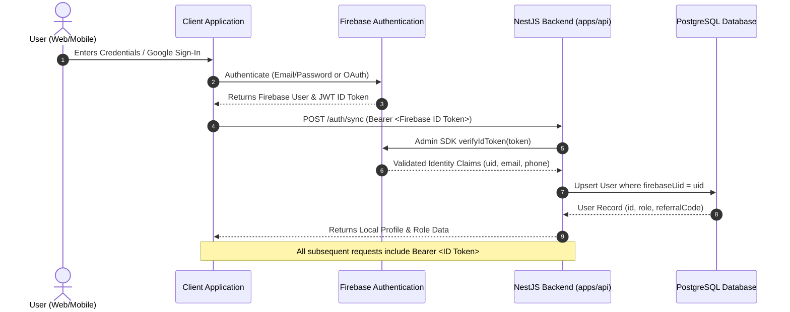

# LaptopMitra — AI Handoff: Authentication & Security

## 1. Authentication Architecture: Hybrid Identity Model

LaptopMitra decouples **Identity Verification** from **Application Data Persistence**:



### Key Principles
1. **Zero Password Storage on Server**: Passwords, OAuth credential handshakes, and identity sessions are handled by Firebase Authentication.
2. **Local Identity Anchor**: Every customer record in PostgreSQL has a canonical UUID `User.id` and an indexed `User.firebaseUid`. All business relationships (orders, warranties, tickets, affiliate balances) reference the internal `User.id`.
3. **Decoupled Verification**: If Firebase is temporarily degraded or offline, existing session tokens can still be decoded or validated against public certs.

---

## 2. Token Lifecycle & Guard Pipeline

### `FirebaseAuthGuard` (`src/auth/guards/firebase-auth.guard.ts`)
Configured as a global guard across all HTTP endpoints in `AppModule`.

1. **Public Route Bypass**: Checks for `@Public()` metadata. If found, request is allowed through without checking authorization headers.
2. **Token Extraction**: Extracts token from `Authorization: Bearer <token>`. Returns `401 Unauthorized` with error code `TOKEN_INVALID` if missing or malformed.
3. **Admin SDK Verification**: Invokes `firebaseService.verifyIdToken(token, checkRevoked)`.
   - If token is expired: Returns `401 Unauthorized` with code `TOKEN_EXPIRED`.
   - If audience/project mismatch: Returns `401 Unauthorized` with code `TOKEN_WRONG_PROJECT`.
4. **Database Identity Resolution**:
   - Queries `prisma.user.findUnique({ where: { firebaseUid: identity.uid } })`.
   - If user does not exist yet: Checks for `@AllowUnlinkedFirebaseUser()`. If allowed (such as during `/auth/sync`), lets the request proceed so the user can be provisioned. Otherwise, returns `401` with `TOKEN_INVALID`.
   - If user exists but `status !== 'ACTIVE'`: Returns `401 Unauthorized` ("This account is currently suspended or inactive").
5. **Context Attachment**: Attaches `request.user` (local database user entity) and `request.firebaseIdentity` (decoded Firebase claims).

---

## 3. Role-Based Access Control (RBAC)

### Roles Hierarchy
- **`CUSTOMER`**: Default role for registered users. Can purchase, rent, manage their own laptops, book service jobs, view their orders, and participate in the Mitra referral program.
- **`GUEST`**: Anonymous role created for temporary cart sessions. Prohibited from checkout or payment operations until linked with a registered account.
- **`MODERATOR`**: Support staff tier. Can triage tickets, review return requests, and view customer 360 data, but cannot alter system settings, deploy code, or execute financial payouts.
- **`ADMIN`**: Superuser tier. Unrestricted access to administrative consoles, product pricing approval, CSV data import/export, and financial withdrawal approvals.

### `RolesGuard` (`src/guards/roles.guard.ts`)
Applied to specific controller classes or methods using `@Roles('ADMIN', 'MODERATOR')`:
```typescript
@UseGuards(RolesGuard)
@Roles('ADMIN')
@Controller('admin')
export class AdminController {}
```

---

## 4. Cryptographic Security & Financial Encryption

### Sensitive Payment Data Encryption (`PaymentEncryptionService`)
Bank account numbers, IFSC codes, and UPI IDs collected from affiliates and customers are classified as highly sensitive financial data.

- **Algorithm**: `AES-256-GCM` (Galois/Counter Mode) providing authenticated symmetric encryption.
- **Key Requirement**: A 32-byte (256-bit) cryptographically random hexadecimal key supplied via `PAYMENT_ENCRYPTION_KEY`.
- **Payload Format**: Encrypted values are stored as a colon-delimited string:
  ```
  <IV_HEX>:<AUTH_TAG_HEX>:<CIPHERTEXT_HEX>
  ```
- **Guarantees**:
  - Encrypted at rest in PostgreSQL.
  - Plaintext is never logged or returned in public API payloads (masked by default, e.g. `****3921`).
  - Decrypted solely on-demand inside administrative payout review endpoints (`/admin/withdrawals/:id/payment-details`).

---

## 5. Network & Transport Security

### 1. Helmet Headers
The API registers `helmet()` in `main.ts` with explicit security settings:
- Strict `X-Content-Type-Options: nosniff`
- `X-Frame-Options: SAMEORIGIN`
- Cross-Origin Resource Policy: `cross-origin`

### 2. Hardened CORS Validation (`src/common/cors.ts`)
- **Strict Allow-List**: Origins are parsed from `CORS_ORIGINS` (e.g. `http://localhost:3000,https://laptopmitra.com`).
- **Production Guard**: In production (`NODE_ENV === 'production'`), startup is terminated immediately if `CORS_ORIGINS` is missing or contains wildcards (`*`).
- **Dynamic Origin Check**: Inspects incoming request origins against an exact match or approved subdomain regex.

### 3. Rate Limiting (`@nestjs/throttler`)
- Configured globally with `ThrottlerGuard` in `AppModule`.
- Default: **100 requests per minute** per client IP.
- Express adapter trusts the reverse proxy (`app.set('trust proxy', 1)`) so rate limiting evaluates real client IPs from `X-Forwarded-For` rather than the load balancer IP.

---

## 6. Administrative Bootstrap & Promotion

To avoid hardcoded admin credentials in database seed files, the codebase includes dedicated administrative CLI utilities:

### Bootstrap Initial Admin (`apps/api/scripts/bootstrap-admin.ts`)
```bash
pnpm --filter api run admin:bootstrap --email admin@laptopmitra.com
```
Validates the user in Firebase, creates or updates their PostgreSQL record, sets `role = 'ADMIN'`, and confirms administrative access.

### Promote Existing User (`apps/api/scripts/promote-admin.ts`)
```bash
pnpm --filter api run admin:promote --email staff@laptopmitra.com --role MODERATOR
```
Upgrades an active customer to `MODERATOR` or `ADMIN`.
