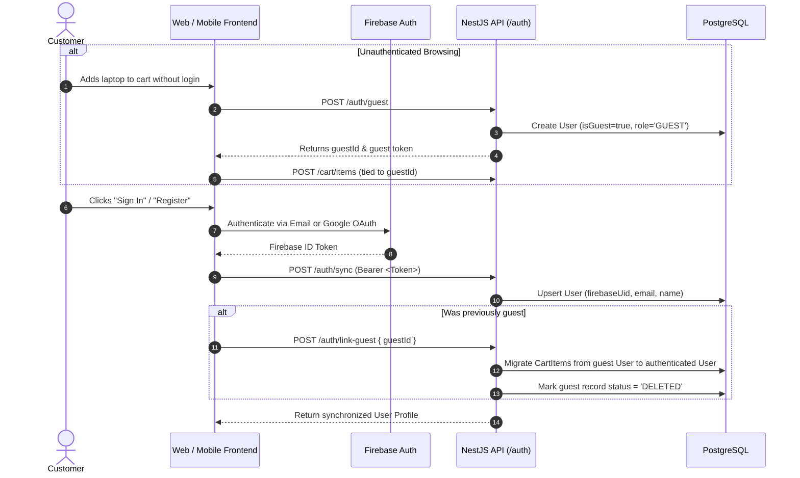
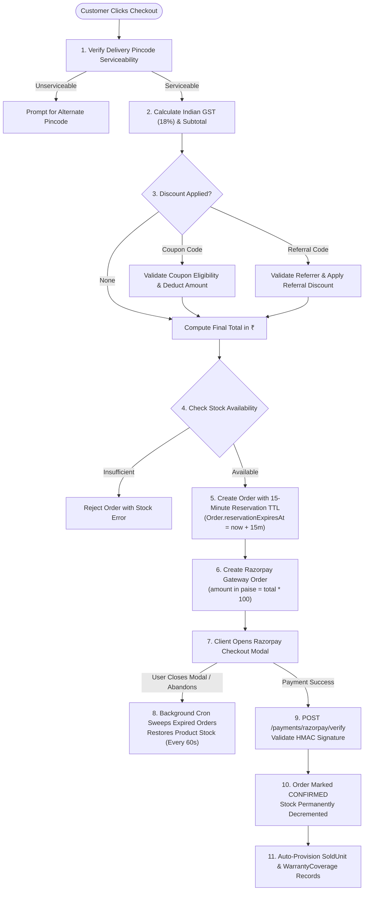
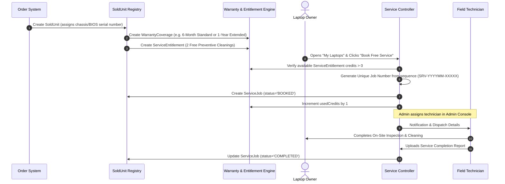

# LaptopMitra — AI Handoff: Business Logic & Workflows

This document details the core end-to-end business workflows implemented across the system.

---

## 1. User Registration, Profile Sync & Guest Cart Linking



---

## 2. Product Ordering, 15-Minute Reservation & Tax Compliance



### Business Rules
- **Currency Standard**: All catalog prices, line totals, discounts, taxes, and order values are maintained in Indian Rupees (₹) as `Decimal(10, 2)`. Conversion to paise occurs strictly at the Razorpay SDK call boundary (`amount * 100`).
- **Reservation TTL**: `OrderService` maintains an automated background timer sweeping abandoned reservations older than 15 minutes. This ensures that users abandoning payments do not cause inventory starvation for other buyers.
- **GST Compliance**: Standard electronic goods GST of 18% is applied (`TaxService`). Invoices format tax amounts with explicit CGST (9%) and SGST (9%) or IGST (18%) breakdowns based on customer state versus supplier state.

---

## 3. Digital Device Passport & Servicing Workflow

When an order containing laptops transitions to `CONFIRMED` or `DELIVERED`:



---

## 4. Laptop Rental, Subscriptions & Lease-to-Own

For customers leasing enterprise laptops:
1. **Rental Plan Selection**: Customer chooses tenure (3, 6, or 11 months).
2. **Security Deposit & First Month Rent**: Customer pays security deposit + first month rent via Razorpay.
3. **Recurring Mandates**: Razorpay Subscription mandate is created for subsequent monthly billing cycles.
4. **Lease-to-Own Buyout Calculation**:
   - At any point after 3 months of continuous leasing, the customer may request a buyout quote (`POST /lease/contracts/:id/buyout-request`).
   - The system calculates depreciated residual value:
     $$\text{Buyout Price} = \text{Original Value} - (\text{Rent Paid} \times 0.6) - \text{Security Deposit}$$
   - If accepted, payment is captured, the lease is terminated, and a `SoldUnit` ownership record is issued to the customer.

---

## 5. Buyback Guarantee Lifecycle

Every refurbished laptop purchased on LaptopMitra carries a guaranteed buyback value according to the depreciation tier schedule:

| Ownership Duration | Condition Grade A+ | Condition Grade A | Condition Grade B |
|---|---|---|---|
| **Up to 6 Months** | 70% of purchase price | 65% of purchase price | 55% of purchase price |
| **7 to 12 Months** | 55% of purchase price | 50% of purchase price | 40% of purchase price |
| **13 to 24 Months** | 40% of purchase price | 35% of purchase price | 25% of purchase price |

### Execution Workflow:
1. **Customer Request**: Customer selects the laptop in their account and requests buyback.
2. **Reverse Pickup**: Courier pickup is dispatched to collect the machine.
3. **Hub Diagnostic Inspection**: Technicians verify cosmetic grade, display defects, battery wear, and internal components.
4. **Revised Quote (if required)**: If condition does not match declared grade, a revised offer is published.
5. **Customer Decision**: Customer can accept the revised offer or decline (in which case the laptop is returned).
6. **Encrypted Disbursal**: Once accepted, payout is issued directly to the customer's verified bank account or UPI ID.

---

## 6. Mitra Affiliate Referral & Payout Workflow

```mermaid
sequenceDiagram
    autonumber
    actor Referrer as Mitra Partner (User A)
    actor Buyer as Buyer (User B)
    participant API as NestJS API
    participant DB as PostgreSQL (Interactive Transaction)
    actor Admin as Finance Admin

    Referrer->>Buyer: Shares unique referral code / link (e.g. LM-SHIVA)
    Buyer->>API: Places order applying LM-SHIVA
    API->>DB: Validate code; apply 5% discount to Buyer order
    API->>DB: Credit Referrer commission to referralEarnings (status='RESERVED_ON_ORDER')
    
    Note over API,DB: After 7-day return window expires without return
    API->>DB: Commission shifts from pending to available balance
    
    Referrer->>API: Configures Bank Account / UPI ID
    API->>DB: AES-256-GCM Encrypts & Stores in AffiliatePaymentDetails
    
    Referrer->>API: POST /discount/withdraw { amount: 5000 }
    API->>DB: BEGIN TRANSACTION (Row-Level Lock)
    API->>DB: Verify (referralEarnings - referralReserved - referralWithdrawn) >= 5000
    API->>DB: Increment referralReserved by 5000
    API->>DB: Create WithdrawalRequest (status='PENDING', snapshot=EncryptedBankingData)
    API->>DB: COMMIT TRANSACTION
    
    Admin->>API: GET /admin/withdrawals/:id/payment-details
    API-->>Admin: Decrypts bank details for transfer
    Admin->>Admin: Processes NEFT / IMPS transfer
    Admin->>API: PUT /admin/withdrawals/:id/status { status: 'PAID' }
    API->>DB: Decrement referralReserved by 5000; Increment referralWithdrawn by 5000
```
