# LaptopMitra — AI Handoff: Database Documentation

## 1. Database Architecture & Technology

- **Database Engine**: PostgreSQL 14+ / 16 (Hosted on Supabase, Render, or Neon).
- **ORM / Schema Management**: Prisma ORM `6.4.1` with native PostgreSQL extensions and sequence generators.
- **Connection Strategy**: Single pooled connection URL via `DATABASE_URL` with explicit SSL parameters (`sslmode=require`).
- **Safety Enforcement**: Hard stops via `scripts/db-command.cjs` and `.db-protected-hosts` prevent running `db push`, `migrate reset`, or developmental schema alterations against production hosts.

---

## 2. Complete Entity-Relationship Overview

The database comprises 37 interconnected models organized into 7 cohesive functional clusters:

```mermaid
erDiagram
    User ||--o{ Order : places
    User ||--o{ Address : has
    User ||--o{ Cart : maintains
    User ||--o{ Wishlist : saves
    User ||--o{ SupportTicket : opens
    User ||--o{ ServiceJob : books
    User ||--o{ SoldUnit : owns
    User ||--o{ WithdrawalRequest : submits
    User ||--o| AffiliatePaymentDetails : configures
    User ||--o{ RentalSubscription : leases
    User ||--o{ BuybackRequest : requests

    Order ||--|{ OrderItem : contains
    Order ||--o| Payment : receives
    Order ||--o| Delivery : tracks
    Order ||--o{ LeaseContract : generates

    Product ||--|{ ProductVariant : has
    Product ||--o{ ProductImage : displays
    Product ||--o{ RentalPrice : configures
    Category ||--o{ Product : categorizes

    SoldUnit ||--o| WarrantyCoverage : covered_by
    SoldUnit ||--o{ ServiceEntitlement : grants
    SoldUnit ||--o{ ServiceJob : repairs

    SupportTicket ||--|{ TicketMessage : contains
    SupportTicket ||--o{ TicketAttachment : includes
    SupportTicket ||--o{ TicketEvent : logs
```



---

## 3. Schema Reference: Core Models & Data Dictionaries

### A. Core User & Identity

#### `User`
The primary identity record. Synchronized with Firebase Authentication via `firebaseUid`.
- `id` (String, UUID, PK): Internal surrogate key referenced across all business tables.
- `firebaseUid` (String, Unique): External identity key from Firebase Authentication.
- `email` (String, Unique, Nullable): Primary user email address.
- `emailVerified` (DateTime, Nullable): Timestamp of email verification confirmation.
- `name` (String, Nullable): Customer or staff display name.
- `phone` (String, Nullable): Primary contact phone number.
- `role` (String, Default: `"CUSTOMER"`): Access tier (`CUSTOMER`, `ADMIN`, `MODERATOR`, `GUEST`).
- `status` (String, Default: `"ACTIVE"`): Account state (`ACTIVE`, `SUSPENDED`, `DELETED`).
- `referralCode` (String, Unique): Unique 6-character referral code generated for every user.
- `referralEarnings` (Decimal, Default: `0.00`): Lifetime cumulative earnings from referral commissions.
- `referralReserved` (Decimal, Default: `0.00`): Currency currently locked in pending withdrawal requests.
- `referralWithdrawn` (Decimal, Default: `0.00`): Currency successfully disbursed to user.
- `referralTier` (String, Default: `"BASIC"`): Tier level (`BASIC`, `GOLD`, `PLATINUM`).
- `createdAt` / `updatedAt` (DateTime): Audit timestamps.

#### `Address`
Customer shipping and billing addresses.
- `id` (String, UUID, PK)
- `userId` (String, FK -> `User.id`)
- `fullName` (String, Nullable)
- `phone` (String, Nullable)
- `address` (String): Street address / building / flat.
- `city` / `state` / `pincode` (String): Geographic delivery target.
- `isDefault` (Boolean, Default: `false`)

#### `DeviceToken`
Push notification tokens registered by mobile devices.
- `id` (String, UUID, PK)
- `userId` (String, FK -> `User.id`)
- `token` (String, Unique): Expo push notification token or FCM token.
- `platform` (String): `android` or `ios`.

#### `OtpChallenge`
Cryptographically secured one-time passwords for password reset and email verification.
- `id` (String, UUID, PK)
- `userId` (String, FK -> `User.id`, Nullable)
- `identifier` (String): Normalized email address or phone number.
- `codeHash` (String): Salted bcrypt or SHA-256 hash of the 6-digit OTP code.
- `purpose` (String): `EMAIL_VERIFICATION` | `PASSWORD_RESET`.
- `expiresAt` (DateTime): Challenge expiry (default 10 minutes).
- `attempts` (Int, Default: `0`): Failed attempt counter (max 5).
- `consumedAt` (DateTime, Nullable): Timestamp of successful verification.

---

### B. Catalog, Products & Inventory

#### `Category`
Hierarchical product taxonomy.
- `id` (String, UUID, PK)
- `name` (String): Category display name (e.g. "Business Laptops", "Gaming").
- `slug` (String, Unique): URL-safe slug.
- `description` (String, Nullable)
- `parentId` (String, FK -> `Category.id`, Nullable): Supports nested subcategories.

#### `Product`
Master product definitions for refurbished laptops and accessories.
- `id` (String, UUID, PK)
- `name` (String): Product title (e.g. "Lenovo ThinkPad T480").
- `slug` (String, Unique): SEO URL slug.
- `description` / `shortDescription` (String, Nullable)
- `sku` (String, Unique): Stock Keeping Unit master code.
- `price` (Decimal): Base purchase price in INR.
- `compareAtPrice` (Decimal, Nullable): Original MSRP before refurbishment discount.
- `stock` (Int, Default: `0`): Overall available inventory counter.
- `condition` (String, Default: `"EXCELLENT"`): Refurbishment grade (`NEW`, `EXCELLENT`, `VERY_GOOD`, `GOOD`).
- `brand` / `processor` / `ram` / `storage` (String, Nullable): Search facet attributes.
- `categoryId` (String, FK -> `Category.id`)
- `isActive` (Boolean, Default: `true`)

#### `ProductVariant`
Specific hardware combinations (e.g., 16GB RAM / 512GB SSD vs 32GB RAM / 1TB SSD).
- `id` (String, UUID, PK)
- `productId` (String, FK -> `Product.id`)
- `name` (String): Variant title (e.g. "16GB RAM • 512GB NVMe").
- `sku` (String, Unique)
- `attributes` (Json): Key-value dictionary of specs.
- `price` (Decimal): Variant purchase price.
- `leasePriceMonthly` (Decimal, Nullable): Monthly rental rate.
- `stock` (Int, Default: `0`)
- `isDefault` (Boolean, Default: `false`)

#### `RentalPrice` & `RentalPriceAudit`
Flexible rental plan definitions and changes audit trail.
- `id` (String, UUID, PK)
- `productId` (String, FK -> `Product.id`)
- `tenureMonths` (Int): 3, 6, or 11 months.
- `monthlyRent` (Decimal): Monthly recurring fee in INR.
- `securityDeposit` (Decimal): Refundable deposit in INR.
- `status` (String): `DRAFT` | `ACTIVE` | `ARCHIVED`. Requires admin approval workflow.

---

### C. Orders, Checkout & Payments

#### `Order`
Customer purchases and rental contracts.
- `id` (String, UUID, PK): Master order UUID.
- `orderNumber` (String, Unique): Human-friendly order number (e.g. `ORD-202611-00123`).
- `userId` (String, FK -> `User.id`)
- `status` (String): `PENDING` | `CONFIRMED` | `PROCESSING` | `SHIPPED` | `DELIVERED` | `CANCELLED` | `RETURNED`.
- `totalAmount` (Decimal): Final payable amount after taxes and discounts.
- `subtotal` (Decimal): Pre-tax items total.
- `taxAmount` (Decimal): Calculated Indian GST (18%).
- `discountAmount` (Decimal, Default: `0.00`): Discount applied.
- `shippingAmount` (Decimal, Default: `0.00`)
- `orderType` (String, Default: `"PURCHASE"`): `PURCHASE` | `RENTAL` | `LEASE`.
- `deliveryAddress` (Json): Frozen snapshot of shipping address at order time.
- `couponCode` (String, Nullable): Applied discount coupon code.
- `referralCode` (String, Nullable): Applied affiliate referral code.
- `reservationExpiresAt` (DateTime, Nullable): 15-minute stock reservation TTL.

#### `OrderItem`
Line items in an order.
- `id` (String, UUID, PK)
- `orderId` (String, FK -> `Order.id`)
- `productId` (String, FK -> `Product.id`)
- `variantId` (String, FK -> `ProductVariant.id`, Nullable)
- `quantity` (Int)
- `unitPrice` (Decimal)
- `totalPrice` (Decimal)
- `itemStatus` (String, Default: `"ACTIVE"`): `ACTIVE` | `CANCELLED` | `RETURN_REQUESTED` | `RETURNED`.

#### `Payment`
Payment transaction records.
- `id` (String, UUID, PK)
- `orderId` (String, FK -> `Order.id`, Unique)
- `provider` (String, Default: `"RAZORPAY"`): `RAZORPAY` | `CASH_ON_DELIVERY`.
- `transactionId` (String, Nullable): Razorpay payment ID (`pay_...`).
- `gatewayOrderId` (String, Nullable): Razorpay order ID (`order_...`).
- `amount` (Decimal): Transaction amount in INR.
- `currency` (String, Default: `"INR"`)
- `status` (String): `PENDING` | `AUTHORIZED` | `CAPTURED` | `FAILED` | `REFUNDED`.
- `rawResponse` (Json, Nullable): Gateway response payload.

#### `Delivery`
Shipping carrier tracking and courier assignment.
- `id` (String, UUID, PK)
- `orderId` (String, FK -> `Order.id`, Unique)
- `trackingNumber` (String, Nullable)
- `courierName` (String, Nullable): e.g. Delhivery, BlueDart, DTDC.
- `status` (String): `MANIFESTED` | `IN_TRANSIT` | `OUT_FOR_DELIVERY` | `DELIVERED`.
- `estimatedDelivery` (DateTime, Nullable)

---

### D. Digital Device Passport & Servicing

#### `SoldUnit`
Tracks physical machines delivered to customers for warranty and servicing.
- `id` (String, UUID, PK)
- `serialNumber` (String, Unique): Physical hardware serial number (e.g. BIOS / Chassis serial).
- `orderItemId` (String, FK -> `OrderItem.id`, Unique)
- `userId` (String, FK -> `User.id`): Registered owner.
- `status` (String): `ACTIVE` | `REPLACED` | `DECOMMISSIONED` | `BUYBACK_RETURNED`.

#### `WarrantyCoverage`
Warranty policy assigned to a sold unit.
- `id` (String, UUID, PK)
- `soldUnitId` (String, FK -> `SoldUnit.id`, Unique)
- `warrantyType` (String): `STANDARD_6_MONTH` | `EXTENDED_1_YEAR` | `AMC_PREMIUM`.
- `startDate` / `endDate` (DateTime)
- `isActive` (Boolean, Default: `true`)

#### `ServiceEntitlement`
Available free preventive maintenance and cleaning service credits.
- `id` (String, UUID, PK)
- `soldUnitId` (String, FK -> `SoldUnit.id`)
- `userId` (String, FK -> `User.id`)
- `serviceType` (String): `PREVENTIVE_MAINTENANCE` | `INTERNAL_CLEANING` | `THERMAL_PASTE`.
- `totalCredits` (Int, Default: `2`)
- `usedCredits` (Int, Default: `0`)
- `validUntil` (DateTime)

#### `ServiceJob`
Doorstep technician service appointments.
- `id` (String, UUID, PK)
- `jobNumber` (String, Unique): Formatted as `SRV-YYYYMM-XXXXX` from Postgres sequence `service_job_seq`.
- `soldUnitId` (String, FK -> `SoldUnit.id`)
- `customerId` (String, FK -> `User.id`)
- `assignedTechnicianId` (String, FK -> `User.id`, Nullable)
- `status` (String): `BOOKED` | `ASSIGNED` | `IN_PROGRESS` | `COMPLETED` | `CANCELLED`.
- `scheduledDate` (DateTime)
- `timeSlot` (String): e.g. "10:00 AM - 01:00 PM".
- `customerNotes` (String, Nullable)

---

### E. Affiliate & Mitra Program

#### `AffiliatePaymentDetails`
Bank account and UPI configuration for commission disbursements.
- `id` (String, UUID, PK)
- `userId` (String, FK -> `User.id`, Unique)
- `accountHolderName` (String, Nullable)
- `bankName` (String, Nullable)
- `accountNumber` (String, Nullable): **AES-256-GCM encrypted string**.
- `ifscCode` (String, Nullable): **AES-256-GCM encrypted string**.
- `upiId` (String, Nullable): **AES-256-GCM encrypted string**.
- `qrCodeKey` (String, Nullable): Storage key pointing to encrypted QR image in private storage.

#### `WithdrawalRequest`
Partner withdrawal claims with strict transactional integrity.
- `id` (String, UUID, PK)
- `userId` (String, FK -> `User.id`)
- `amount` (Decimal): Requested withdrawal in INR.
- `status` (String): `PENDING` | `APPROVED` | `REJECTED` | `PAID`.
- `paymentMethodSnapshot` (String): Encrypted JSON string capturing snapshot of banking details at the instant of request creation.
- `adminNotes` (String, Nullable)
- `processedAt` (DateTime, Nullable)

---

### F. Support Helpdesk, Buyback & Returns

#### `SupportTicket` & `TicketMessage`
Customer inquiry threads with auto-incrementing ticket numbers.
- `id` (String, UUID, PK)
- `ticketNumber` (String, Unique): e.g. `TKT-10023`.
- `customerId` (String, FK -> `User.id`)
- `assignedStaffId` (String, FK -> `User.id`, Nullable)
- `category` (String): `ORDER_INQUIRY` | `HARDWARE_ISSUE` | `WARRANTY_CLAIM` | `RENTAL_EXTENSION`.
- `priority` (String): `LOW` | `MEDIUM` | `HIGH` | `CRITICAL`.
- `status` (String): `OPEN` | `WAITING_ON_CUSTOMER` | `IN_PROGRESS` | `RESOLVED` | `CLOSED`.

#### `BuybackRequest`
Customer trade-in requests under the Buyback Guarantee policy.
- `id` (String, UUID, PK)
- `userId` (String, FK -> `User.id`)
- `orderItemId` (String, FK -> `OrderItem.id`)
- `initialEstimate` (Decimal): Initial guaranteed estimate based on depreciation matrix.
- `revisedOffer` (Decimal, Nullable): Adjusted price following physical hub inspection.
- `status` (String): `REQUESTED` | `DEVICE_RECEIVED` | `INSPECTED` | `OFFER_ACCEPTED` | `PAID` | `RETURN_REJECTED`.

---

## 4. Concurrency Controls & Critical Queries

### 1. Affiliate Withdrawal Concurrency Guard
To eliminate race conditions (such as double withdrawals), `discount.service.ts` uses interactive transactions with row-level locks:

```typescript
await this.prisma.$transaction(async (tx) => {
  // 1. Fetch user within transaction
  const user = await tx.user.findUnique({ where: { id: userId } });
  
  // 2. Compute available balance
  const available = Number(user.referralEarnings) - Number(user.referralReserved) - Number(user.referralWithdrawn);
  if (amount > available) {
    throw new BadRequestException('Insufficient available referral earnings');
  }

  // 3. Atomically lock amount in reserved counter
  await tx.user.update({
    where: { id: userId },
    data: { referralReserved: { increment: amount } },
  });

  // 4. Create withdrawal request with encrypted payment snapshot
  return tx.withdrawalRequest.create({
    data: { userId, amount, status: 'PENDING', paymentMethodSnapshot: encryptedSnapshot },
  });
});
```

### 2. High-Performance Sequence Generators
Sequential human-readable codes (`SRV-YYYYMM-XXXXX` and `RCP-YYYYMM-XXXXX`) are generated via native PostgreSQL sequences:
```sql
SELECT nextval('service_job_seq') as seq;
SELECT nextval('service_receipt_seq') as seq;
```
This guarantees collision-free IDs across concurrent booking requests without lock contention on master tables.
