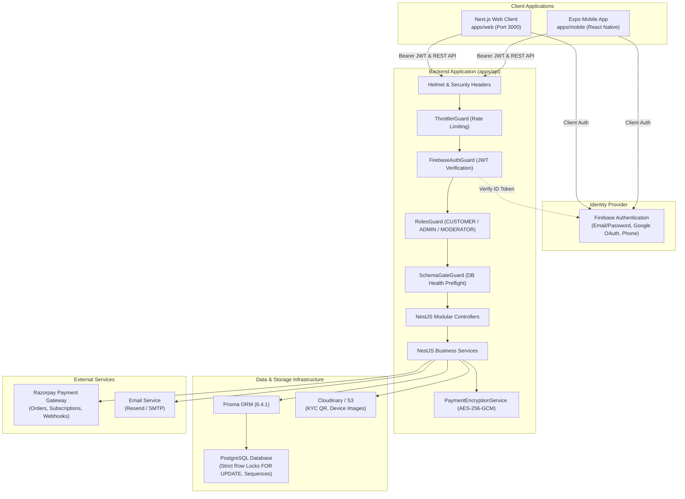

# LaptopMitra — AI Handoff: Project Overview

## 1. Executive Summary & Purpose

**LaptopMitra** is a full-featured commercial e-commerce, rental, AMC servicing, buyback, and affiliate platform purpose-built for the Indian refurbished and enterprise IT hardware market. 

Historically migrated from a legacy procedural PHP monolith (`public_htmlphp`), the platform has been re-architected into a modern TypeScript-first monorepo. It serves three client interfaces:
1. **Desktop & Mobile Web Platform (`apps/web`)**: A high-performance Next.js 16 (React 19) App Router e-commerce application with dynamic filtering, live Razorpay checkout, comprehensive customer self-service portals, and full administrative CRM/ERP consoles.
2. **Native Mobile Application (`apps/mobile`)**: A cross-platform Expo React Native application targeting Android and iOS, implementing 1:1 feature parity with web customer accounts, push notifications, and Razorpay SDK integration.
3. **Backend API Gateway (`apps/api`)**: A NestJS 11 enterprise REST API backed by Prisma ORM and PostgreSQL, featuring Firebase Auth identity synchronization, cryptographic payment data encryption, transactional concurrency safeguards for financial payouts, automated lifecycle triggers, and audit ledgers.

---

## 2. Technology Stack & Exact Versions

| Tier / Role | Technology / Library | Version | Purpose |
|---|---|---|---|
| **Monorepo Engine** | Turborepo | `2.10.12` | High-performance monorepo build orchestration & task caching |
| **Package Manager** | pnpm | `8.15.4` | Strict workspace dependency management, content-addressable store |
| **Language Runtime** | Node.js | `>=18` (Node 22 / 26 compatible) | Core JavaScript/TypeScript execution runtime |
| **Backend Framework** | NestJS | `^11.0.0` | Modular, dependency-injected enterprise HTTP microservices |
| **Database ORM** | Prisma ORM | `6.4.1` | Type-safe schema definition, PostgreSQL migrations, connection pooling |
| **Database Engine** | PostgreSQL | `14+` / `16` (Supabase / Render / Neon) | Relational database with row-level locks and sequence generators |
| **Frontend Framework** | Next.js | `16.3.4` (App Router) | Server-side rendering, streaming SSR, static generation, React Server Components |
| **Frontend UI Library** | React | `19.2.8` | Declarative UI components |
| **Frontend Styling** | Tailwind CSS | `^4.0.0` | Utility-first design tokens and responsive styling |
| **Mobile Framework** | Expo SDK | `~57.0.33` (React Native `0.86.3`) | Native Android (APK/AAB) & iOS application platform |
| **Mobile UI / Nav** | React Navigation | `^7.0.13` | Native stack and bottom tab navigation |
| **Client State / Cache** | TanStack React Query | `^5.68.0` | Asynchronous query caching, automatic retries, optimistic updates |
| **Client State (Mobile)** | Zustand | `^5.0.15` | Lightweight client-side persisted state |
| **Form Validation** | Zod + React Hook Form | `^3.24.1` / `^7.53.0` | Isomorphic runtime schema validation and form controller |
| **Identity & Auth** | Firebase Admin / Client | `^13.10.0` (Admin), `^12.19.0` (Client) | Multi-provider authentication, JWT issuance, phone/Google OAuth |
| **Payment Gateway** | Razorpay Node SDK | `^2.9.0` (API), `^3.0.0` (Mobile) | Indian Rupee orders, subscription recurring mandates, webhooks |
| **Security Headers** | Helmet | `^8.3.0` | Express security HTTP headers |
| **API Documentation** | Swagger / OpenAPI | `^8.0.0` | Auto-generated interactive API documentation (mounted at `/api`) |
| **Transactional Email** | Resend / Nodemailer | `^6.34.1` (Resend), `^10.2.1` (Nodemailer) | Multi-driver email dispatch (Console, SMTP, Resend) |
| **E2E Visual Testing** | Playwright | `^1.64.1` | Cross-browser visual regression and screenshot testing |

---

## 3. High-Level System Architecture

---

## 4. Major Features & Domain Modules

### 1. Refurbished Laptop Store & Product Catalog
- **Multi-variant inventory**: Attributes for Processor, RAM, Storage (SSD/NVMe), Screen Size, Graphic Card, Condition Grade (A+/A/B).
- **Faceted Search & Dynamic Filters**: Filter by category, price ranges, brand, generation, form factor.
- **Stock Reservation**: 15-minute checkout reservation TTL with automated cron sweeps to prevent phantom inventory lockups.

### 2. Laptop Rental & Subscription Service
- **Flexible tenure**: 3, 6, 11-month rental terms with customizable security deposit.
- **Subscription management**: Razorpay recurring billing mandates and rental contract lifecycle tracking.
- **Lease-to-Own**: Transition from rental to buyout with dynamic depreciated buyout quotes.

### 3. Customer Service, AMC & Warranty
- **Digital Device Passport**: Every sold unit is assigned a tracked serial number (`SoldUnit`), warranty tier (`WarrantyCoverage`), and free service entitlement counter (`ServiceEntitlement`).
- **Doorstep Technician Booking**: Step-by-step service job booking, auto-assigned service job numbers (`SRV-YYYYMM-XXXXX`) via Postgres sequences, technician dispatch, rescheduling, and cancellation with full immutable audit events.

### 4. Buyback Guarantee
- **Guaranteed Resale Value**: Transparent depreciation formula based on age (6, 12, 18, 24 months) and physical grade.
- **Inspection & Reverse Logistics**: Customer submits buyback request, laptop is inspected at hub, revised quotes can be accepted or rejected by user, and payout is executed via encrypted banking details.

### 5. Mitra Affiliate & Referral Engine
- **Unique Referral Links**: Automatic generation of customer referral codes (`User.referralCode`).
- **Tier-based Payouts**: Basic, Gold, and Platinum tiers with commission percentages.
- **Zero-Race Financial Payouts**: Customer balance tracking (`referralEarnings`, `referralReserved`, `referralWithdrawn`). Withdrawal requests trigger strict interactive transactions and Postgres row locks to prevent double-spending. Payout details (bank account / IFSC / UPI / QR code) are AES-256-GCM encrypted.

### 6. Support Helpdesk & Returns Management
- **Intelligent Situation Engine**: Examines order items dynamically to present contextual actions (`REQUEST_RETURN`, `EXTEND_LEASE`, `BOOK_SERVICE`, `BUYOUT_LEASE`, `CLAIM_WARRANTY`).
- **Threaded Ticket System**: Full customer-staff ticket conversation threads with file attachment uploads and auto-incrementing ticket numbers.
- **Returns & Replacement Workflow**: 7-day return requests, admin inspection review, and automated Razorpay refunds.

### 7. Administrative Backoffice Consoles
- **360° User & Customer View**: Centralized user analytics, order history, tickets, devices, and affiliate records.
- **Catalog & Pricing Control**: Product CRUD, CSV catalog import/export, rental pricing drafts with dual-step approval workflow.
- **Financial Audit & Invoicing**: GST-compliant tax calculations (18% Indian GST for electronics), downloadable PDF invoices, and payment webhook tracking.

---

## 5. Monorepo Package Division & Responsibilities

| Directory | Name | Role & Scope |
|---|---|---|
| `apps/api` | `api` | NestJS REST API, Prisma ORM, business logic, auth guards, payments, background schedulers. |
| `apps/web` | `web` | Next.js 16 App Router customer frontend, responsive mobile UI, and admin portal. |
| `apps/mobile` | `mobile` | Expo React Native application for iOS and Android. |
| `packages/types` | `@laptopmitra/types` | Canonical TypeScript interfaces, DTOs, and domain model contracts. |
| `packages/tokens` | `@laptopmitra/tokens` | Shared design system: brand colors, typography, spacing, border radii, shadows. |
| `packages/api-client` | `@laptopmitra/api-client` | Shared type-safe HTTP client with token refresh and error normalization. |
| `packages/env` | `@laptopmitra/env` | Zod-based cross-package environment variable validation. |
| `packages/config` | `@laptopmitra/config` | Shared TypeScript and ESLint base configurations. |
| `rules/` | - | Non-negotiable engineering rules, security constraints, and operational hard stops. |
| `docs/` | - | In-depth technical guides for deployment, database safeguards, and test protocols. |
| `scripts/` | - | Cross-platform utilities (`doctor.cjs`, `db-command.cjs`, `check-api-mismatches.cjs`). |
